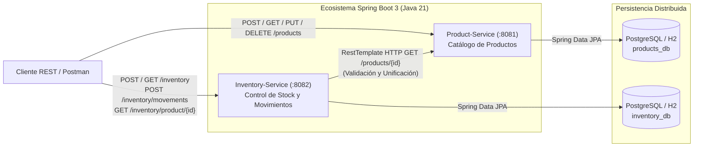

# Sistema de Gestión de Inventario para Mini Market (Arquitectura de Microservicios)

**Universidad Libre — Facultad de Ingeniería — Programación II**  
**Integrantes:** Daniel Felipe Lizarazo Gutiérrez, Nicolás Merchán, Andrés Calderón, Felipe Sánchez

---

## 1. Descripción General

Sistema distribuido basado en microservicios con **Java 21** y **Spring Boot 3.3.5** para administrar el catálogo de productos (`product-service`), controlar las existencias en tiempo real y registrar movimientos de inventario (`inventory-service`) en un Mini Market, comunicándose de manera síncrona mediante APIs REST.

---

## 2. Arquitectura General (Diagrama Mermaid)



---

## 3. Especificación de Endpoints REST

### 3.1. Microservicio `product-service` (Puerto `8081`)

| Método | Endpoint | Descripción | Códigos HTTP |
| :--- | :--- | :--- | :--- |
| `GET` | `/products` | Lista todos los productos del catálogo | `200 OK` |
| `GET` | `/products/{id}` | Obtiene el detalle de un producto por su ID | `200 OK`, `404 NOT FOUND` |
| `POST` | `/products` | Registra un nuevo producto validando reglas de negocio | `201 CREATED`, `400 BAD REQUEST` |
| `PUT` | `/products/{id}` | Actualiza la información de un producto existente | `200 OK`, `400 BAD REQUEST`, `404 NOT FOUND` |
| `DELETE` | `/products/{id}` | Elimina un producto del catálogo | `204 NO CONTENT`, `404 NOT FOUND` |

### 3.2. Microservicio `inventory-service` (Puerto `8082`)

| Método | Endpoint | Descripción | Códigos HTTP |
| :--- | :--- | :--- | :--- |
| `GET` | `/inventory` | Lista todos los registros de existencias en bodega | `200 OK` |
| `GET` | `/inventory/{id}` | Obtiene un registro de inventario por su ID | `200 OK`, `404 NOT FOUND` |
| `POST` | `/inventory` | Asigna stock inicial verificando el producto en `Product-Service` | `201 CREATED`, `404 NOT FOUND`, `400 BAD REQUEST` |
| `PUT` | `/inventory/{id}` | Actualiza existencias y ubicación generando movimiento de `AJUSTE` | `200 OK`, `400 BAD REQUEST`, `404 NOT FOUND` |
| `DELETE` | `/inventory/{id}` | Elimina un registro de inventario | `204 NO CONTENT`, `404 NOT FOUND` |
| `POST` | `/inventory/movements` | Registra un movimiento (`ENTRADA`, `SALIDA`, `AJUSTE`) y actualiza stock | `201 CREATED`, `400 BAD REQUEST`, `404 NOT FOUND` |
| `GET` | `/inventory/movements/product/{productId}` | Consulta el historial de movimientos de un producto | `200 OK` |
| `GET` | `/inventory/product/{productId}` | **Integración REST**: unifica datos del producto, stock e historial | `200 OK`, `404 NOT FOUND` |

---

## 4. Manual de Instalación y Ejecución

### Opción A: Ejecución con Maven (Base de datos H2 en memoria preconfigurada)

1. Compilar ambos microservicios y ejecutar las pruebas unitarias e integradas:
   ```bash
   mvn clean test
   ```
2. Iniciar `product-service` en el puerto `8081`:
   ```bash
   cd product-service
   mvn spring-boot:run
   ```
3. En otra terminal, iniciar `inventory-service` en el puerto `8082`:
   ```bash
   cd inventory-service
   mvn spring-boot:run
   ```

### Opción B: Despliegue Contenerizado con Docker Compose y PostgreSQL 16

```bash
docker compose up --build -d
```

- `product-service`: `http://localhost:8081/products`
- `inventory-service`: `http://localhost:8082/inventory`
- Colección Postman lista para importar en: `MiniMarket_Microservices.postman_collection.json`.
